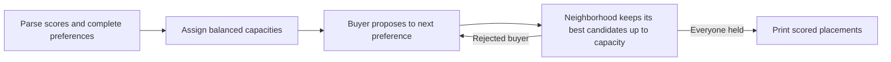

# Buyer placement optimizer

A small standard-library Python solver that places home buyers into neighborhoods. Each buyer ranks every neighborhood. Each neighborhood prefers the buyers who fit it best, measured as the dot product of three scores: energy efficiency (E), water (W) and resilience (R). The solver gives every buyer exactly one place, keeps occupancy balanced, and returns a matching that no buyer and neighborhood would both rather break.

This is a synthetic allocation exercise, not a housing recommendation system.

## Run it

With Docker, no local Python needed:

```sh
docker build -t buyer-placement .
docker run --rm buyer-placement                         # solve the bundled input.txt
docker run --rm -i buyer-placement - < my_input.txt     # solve your own file
```

With Python 3.11 or newer (3.12 is pinned in `.python-version`). There are no runtime dependencies:

```sh
python3 main.py                        # bundled input.txt, placements to stdout
python3 main.py my_input.txt           # your file, placements to stdout
python3 main.py my_input.txt out.txt   # write placements to a file
cat my_input.txt | python3 main.py -   # read from stdin
```

Invalid input stops with exit code 1 and a message that names the line:

```console
$ echo 'N N0 E:1.5 W:1 R:1' | python3 main.py -
Error: E must be an integer on line 1, got '1.5'
```

## Input and output

A neighborhood line gives its three scores. A buyer line gives how much they care about each one, then a complete preference order:

```text
N N0 E:7 W:7 R:10
N N1 E:2 W:1 R:1
H H0 E:3 W:9 R:2 N0>N1
H H1 E:4 W:3 R:7 N1>N0
```

For H0 and N0, compatibility is `3×7 + 9×7 + 2×10 = 104`. With one place per neighborhood, this example prints:

```text
N0: H0(104)
N1: H1(18)
```

Each output line lists a neighborhood's buyers by descending score. The bundled 12-buyer `input.txt` puts four buyers in each of three neighborhoods. Its result is checked in as [generated_output.txt](generated_output.txt):

```text
N0: H5(161) H11(154) H2(128) H4(122)
N1: H9(23) H8(21) H7(20) H1(18)
N2: H6(128) H3(120) H10(86) H0(83)
```

Input rules: E, W and R appear once each as integers, in any order. Names must be unique within neighborhoods and within buyers. Every buyer must rank every neighborhood exactly once. Blank lines are ignored. Anything else is rejected rather than silently dropping a buyer.

## Matching rule

The solver uses buyer-proposing deferred acceptance (Gale–Shapley with capacities):



- **Capacities.** With `B` buyers and `N` neighborhoods, each neighborhood holds `B // N` buyers. The first `B % N` neighborhoods in input order get one extra place. Counts never differ by more than one, even when there are fewer buyers than neighborhoods. A neighborhood left empty prints as `N1:`.
- **Ties.** When two buyers have the same compatibility score, the one that appears earlier in the input wins. The same input therefore always produces the same output.
- **What "optimal" means here.** The result is stable for these capacities and tie rules: no buyer can move to a neighborhood they prefer that would also rank them above someone it currently holds. Among stable matchings, it is the best one for the buyers. It does not maximise the total compatibility score, and it does not model real-world fairness. Choosing which neighborhoods get the remainder places is a policy decision, and a different policy would change the results.

## Code layout

| File | Role |
|---|---|
| `main.py` | Command-line entry point: arguments, stdin/stdout, error exit codes |
| `solver.py` | `PlacementSolver`: input validation, capacities and the deferred-acceptance loop |
| `helpers.py` | Parsing, compatibility scores and output formatting |
| `test_matching.py` | pytest suite |

## Tests and lint

```sh
docker run --rm -v "$PWD":/src:ro -w /src python:3.12-slim \
  sh -c 'pip install -q -r requirements-dev.txt && python -m pytest && python -m ruff check --no-cache .'
```

Locally, run `python3 -m pip install -r requirements-dev.txt`, then `python3 -m pytest` and `ruff check .`.

The suite has 37 tests:

- It regenerates the bundled output.
- It reproduces an old bug where one buyer was placed twice and another was left out.
- It covers ties, empty neighborhoods and UTF-8 names.
- It rejects twelve kinds of malformed input.
- It exercises the command line.
- Across 16 random buyer counts, it checks four properties: every buyer is placed exactly once, occupancy is balanced, no buyer has a better move available, and solving again gives the same result.

## Scale

Scoring is `B × N` multiplications. Each buyer proposes at most `N` times. Each proposal does one ordered insert into a list that is at most one longer than the neighborhood's capacity. Everything stays in memory, which is fine for files of many thousands of lines. The solver has no database, UI, geographic data or validation of what the scores mean.

## License

MIT, see [LICENSE](LICENSE).
